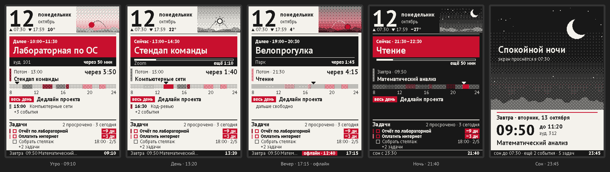

# epaper-calendar

ESP8266 firmware that shows today's schedule and todos from [calendar](https://github.com/Alexander-D-Karpov/calendar) on a 4.2" black/white/red e-paper panel.



## Features

- Current / next event, day timeline, all-day events, overdue todos (up to 14 days)
- Four themes driven by the real sun position (St. Petersburg by default): morning, day, evening, night
- Sleep screen during the sleep window from the account settings
- Live clock, countdowns and progress via fast b/w partial refresh, no flashing
- Full color refresh only when something structural changes, plus a periodic clean-up
- Offline cache in LittleFS, so the screen keeps working without Wi-Fi
- FLASH button toggles a custom picture

## Hardware

| Part | Notes |
|---|---|
| NodeMCU v1.0 (ESP8266, ESP-12E) | 4 MB flash, USB power |
| WeAct Studio 4.2" e-paper, 400×300, b/w/red | GDEY042Z98, SSD1683 controller |
| 8 jumper wires | |

## Wiring

| Display | NodeMCU | GPIO |
|---|---|---|
| VCC | 3V3 | — |
| GND | GND | — |
| SDA (MOSI) | D7 | 13 |
| SCL (SCK) | D5 | 14 |
| CS | D6 | 12 |
| DC | D2 | 4 |
| RES | D1 | 5 |
| BUSY | D0 | 16 |

Power the panel from 3V3, not VIN. The FLASH button (GPIO0) needs no wiring. Don't hold it during reset, or the board enters bootloader mode.

## Setup

1. Create an API token in the calendar under Settings → API tokens, with scopes `account:read`, `calendars:read` and `todos:read`.
2. Fill in `.env`:

   ```bash
   cp .env.example .env
   ```

   | Key | Required | Default |
   |---|---|---|
   | `WIFI_SSID`, `WIFI_PASS` | yes | — |
   | `CAL_TOKEN` | yes | — |
   | `CAL_HOST` | no | `calendar.akarpov.ru` |
   | `TZ_POSIX` | no | `MSK-3` |
   | `GEO_LAT`, `GEO_LON` | no | St. Petersburg |
   | `DISPLAY_ROTATION` | no | `1` (portrait) |
   | `CAL_INSECURE` | no | `0` (set `1` to skip TLS verification) |

3. Build and flash with [PlatformIO](https://platformio.org):

   ```bash
   pio run -t upload
   pio device monitor
   ```

   `.env` is read at build time and baked into the firmware. On the first build, PT Sans is downloaded and rasterized into 1-bit fonts with Cyrillic (`scripts/fonts.py`, needs `freetype-py`, installed automatically).

## How it works

- Polls `/api/v1/changes` every 3 minutes and refetches `/me`, `/calendars`, `/events` (7 days) and `/todos` only when something changed, on a new day, or every 6 hours.
- Partial refresh runs every minute for the clock, countdowns, progress bar and the "now" marker. These areas are kept strictly black/white because the panel's fast mode can't drive red.
- A full refresh happens on event start/end, sun phase change, new data, a new day, sleep, or an online/offline switch. A clean-up full refresh runs every 4 hours.
- TLS uses the Let's Encrypt roots (ISRG X1/X2). JSON is stream-parsed item by item, and a second IRAM heap is enabled to leave DRAM for TLS.

## Layout

```
scripts/   env.py (.env → build flags), fonts.py (font generator)
src/       app      scheduler, refresh logic, button
           api      HTTPS + streaming JSON
           store    LittleFS snapshot cache
           render   screens, dithering, live regions
           agenda   current/next/tomorrow/todos selection
           sun      NOAA sun position and day phases
           text     UTF-8 → font code page, wrapping, ellipsis
```

Tunables (refresh intervals, limits) live in `src/config.h` and `src/model.h`.

## License

[MIT](LICENSE)
